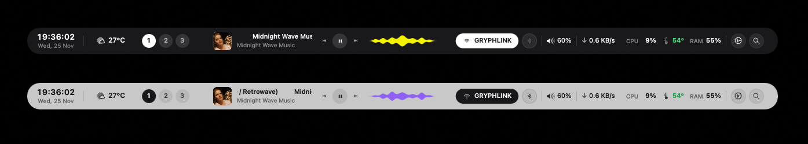

# Plasma Island

<p align="center">
  <strong>All-in-one dynamic status pill & 3-zone top bar widget for KDE Plasma 6</strong>
</p>

<p align="center">
  
  
  
  
</p>

**Plasma Island** is a lightweight, customizable KDE Plasma 6 applet (`com.anzu.plasma-island`) that brings together a clock, weather, virtual workspace switcher, MPRIS media player with a mirrored soundwave visualizer, and a single-fork hardware/system status monitor into one clean capsule or full-width 3-zone bar.

---

## Preview



---

## Features

### 1. Clock (`ClockWidget`)
- **12-hour / 24-hour** toggle and optional **seconds** display.
- **Anti-jitter layout** using OpenType tabular numbers (`tnum`) and `TextMetrics`-measured width.
- **Locale-aware date** formatting (`Qt.formatDate`).

### 2. Weather (`WeatherWidget`)
- Powered by [`wttr.in`](https://wttr.in) JSON API (no API key required).
- Supports **manual city/location** or **IP-based auto-detection** (indicated in tooltip).
- **°C / °F** temperature units, configurable refresh interval (`1–120 min`), and **click-to-refresh**.
- Native Kirigami symbolic weather icons.

### 3. Workspace Switcher (`WorkspaceWidget`)
- Zero-polling native integration with `org.kde.taskmanager` (`VirtualDesktopInfo` & `TasksModel`).
- Click any workspace circle to switch instantly via KWin D-Bus (`qdbus6`), or **scroll anywhere** on the widget to cycle desktops.
- Optional **Hide empty workspaces** toggle.

### 4. Media Player (`MediaWidget`)
- MPRIS2 control via `playerctl` with smart player selection (prioritizes `Playing` state and `plasma-browser-integration` for clean artist/title and real YouTube/web artwork).
- Rounded album art using native Qt 6 `MultiEffect` masking.
- Seamless infinite **marquee scrolling** for long track titles.
- **Previous / Play-Pause / Next** controls with rapid-click sync guard.
- **Mirrored continuous soundwave visualizer** (`Canvas`), plus optional **Auto-hide when no media is playing**.

### 5. System Status Monitor (`StatusWidget`)
- **Single-fork unified telemetry** (~50–70 ms per tick) combining `/proc/meminfo`, `/proc/stat`, `/proc/net/dev`, `hwmon`, and `power_supply` with timeout-guarded CLI queries so no stalled daemon can block updates.
- **Wi-Fi Badge:** Active SSID (`nmcli`), click to open KDE Network Settings.
- **Bluetooth Badge:** Fast `/sys/class/rfkill` + `busctl` state check with 1-click toggle.
- **Battery %:** Automatically hidden on desktop PCs without a battery; full icon range + charging tooltip.
- **Volume %:** Click to mute/unmute, **scroll wheel** (`±5%`, capped at `100%`) via `wpctl`.
- **Hardware Telemetry:** Download speed (`↓`), CPU usage %, CPU temperature (`coretemp` / `k10temp` / `zenpower` priority with thermal color coding), and RAM usage %.
- **Quick Actions:** One-click shortcuts for **System Settings** and **KRunner**.

### 6. Appearance & Configuration
- **Layout Modes:** Switch between **Full-width 3-zone bar** (Left: Clock/Weather/Workspaces, Center: Media, Right: Status) and **Compact Pill**.
- **Dark Mode & Light Mode:** Full adaptive color palettes for text, icons, dividers, badges, and shadows.
- **Live Preview & Presets:** `0%–100%` opacity slider, `0–60 px` corner radius, clickable `ColorDialog` swatches, hex inputs, and **8 built-in presets** (*Dark, Darker, Navy, Forest, Light, Paper, Frost, Warm*).

---

## Requirements

- **KDE Plasma 6.0+** & **Qt 6** (`qt6-declarative`, `kirigami`, `kcmutils`, `plasma5support`)
- Runtime CLI utilities (all optional per module):
  - `playerctl` — Media Player (`plasma-browser-integration` recommended for browser thumbnails)
  - `nmcli` (NetworkManager) — Wi-Fi SSID detection
  - `wpctl` (WirePlumber / PipeWire) — Volume indicator & scroll control
  - `qdbus6` — Virtual desktop switching
  - `rfkill` / `busctl` / `bluetoothctl` — Bluetooth status & toggle

---

## Installation

### From Source (Recommended)
```bash
git clone https://github.com/anzutm/kde-plasma-island.git
cd kde-plasma-island
kpackagetool6 -t Plasma/Applet -i .
```

### Upgrade Existing Installation
```bash
kpackagetool6 -t Plasma/Applet -u .
systemctl --user restart plasma-plasmashell.service
```

### Development Symlink (Live Edits)
```bash
ln -s "$(pwd)" ~/.local/share/plasma/plasmoids/com.anzu.plasma-island
systemctl --user restart plasma-plasmashell.service
```

### Uninstall
```bash
kpackagetool6 -t Plasma/Applet -r com.anzu.plasma-island
```

---

## Usage

1. Right-click your **Desktop** or **Top Panel** → **Add or Manage Widgets...**
2. Search for **Plasma Island** and add it.
3. For a full-width desktop bar, enter **Edit Mode** and resize the widget horizontally to span your screen (or place it inside a full-width Top Panel).
4. Right-click the widget → **Configure Plasma Island...** to customize **Clock & Weather**, **Appearance**, and **Modules**.

---

## Project Structure

```text
kde-plasma-island/
├── assets/
│   └── preview.png
├── contents/
│   ├── config/
│   │   ├── config.qml
│   │   └── main.xml
│   ├── icons/
│   │   └── plasma-island.svg
│   ├── screenshot.png
│   └── ui/
│       ├── main.qml
│       ├── ClockWidget.qml
│       ├── WeatherWidget.qml
│       ├── WorkspaceWidget.qml
│       ├── MediaWidget.qml
│       ├── StatusWidget.qml
│       ├── ConfigGeneral.qml
│       ├── ConfigAppearance.qml
│       └── ConfigModules.qml
├── metadata.json
└── README.md
```

---

## License

Licensed under the [GPL-2.0-or-later](https://www.gnu.org/licenses/old-licenses/gpl-2.0.html) license. See [`metadata.json`](metadata.json) for plugin metadata.
